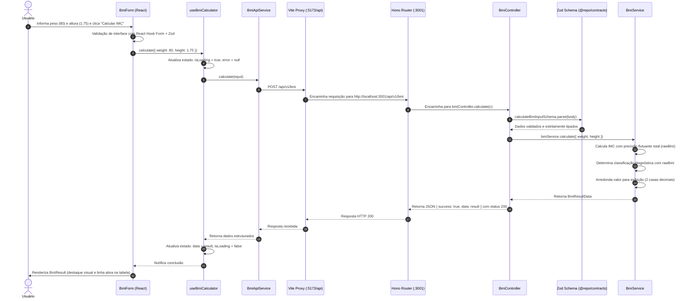

# Manual de Arquitetura e Guia Completo de Uso do Sistema

Este documento apresenta uma visão detalhada, didática e aprofundada de **como utilizar o sistema** e de **como toda a solução funciona internamente (sob o capô)**. Ele foi concebido para servir tanto como documentação de produção quanto como material de apoio para **apresentação e defesa acadêmica**.

---

## Sumário

1. [Visão Geral e Objetivos do Sistema](#1-visão-geral-e-objetivos-do-sistema)
2. [Guia Prático de Utilização](#2-guia-prático-de-utilização)
   - [2.1 Como Executar a Aplicação Localmente](#21-como-executar-a-aplicação-localmente)
   - [2.2 Utilizando a Interface Web (Passo a Passo)](#22-utilizando-a-interface-web-passo-a-passo)
   - [2.3 Utilizando a API Diretamente (cURL, Postman, Insomnia)](#23-utilizando-a-api-diretamente-curl-postman-insomnia)
   - [2.4 Exemplos de Entrada e Saída](#24-exemplos-de-entrada-e-saída)
3. [Como o Sistema Funciona por Baixo dos Panos](#3-como-o-sistema-funciona-por-baixo-dos-panos)
   - [3.1 Ciclo de Vida Completo de uma Requisição (Ponta a Ponta)](#31-ciclo-de-vida-completo-de-uma-requisição-ponta-a-ponta)
   - [3.2 A Camada de Contratos Compartilhados (`packages/contracts`)](#32-a-camada-de-contratos-compartilhados-packagescontracts)
   - [3.3 A Arquitetura do Backend Hono (`apps/api`)](#33-a-arquitetura-do-backend-hono-appsapi)
   - [3.4 A Regra de Negócio: Cálculo Real vs. Formatação](#34-a-regra-de-negócio-cálculo-real-vs-formatação)
   - [3.5 Tratamento Centralizado de Erros e Envelopes](#35-tratamento-centralizado-de-erros-e-envelopes)
   - [3.6 A Arquitetura do Frontend React (`apps/web`)](#36-a-arquitetura-do-frontend-react-appsweb)
4. [Estrutura de Testes Automatizados (58 Testes)](#4-estrutura-de-testes-automatizados-58-testes)
5. [Guia de Apresentação e Defesa Acadêmica](#5-guia-de-apresentação-e-defesa-acadêmica)
   - [5.1 Perguntas Frequentes da Banca e Respostas Técnicas](#51-perguntas-frequentes-da-banca-e-respostas-técnicas)
   - [5.2 Justificativa das Escolhas de Tecnologia](#52-justificativa-das-escolhas-de-tecnologia)

---

## 1. Visão Geral e Objetivos do Sistema

O sistema é uma aplicação web completa projetada para calcular o **Índice de Massa Corporal (IMC)** e categorizar o resultado em uma das 4 faixas diagnósticas oficiais: **Magreza**, **Normal**, **Sobrepeso** ou **Obesidade**.

### Princípios Arquiteturais Fundamentais

1. **Regra de Negócio Centralizada no Backend**: O frontend não realiza cálculo ou classificação prévia. Isso garante segurança, auditoria e uma única fonte de verdade (_Single Source of Truth_).
2. **Arquitetura Orientada a Domínio (Domain-Driven / Feature-Based)**: Em vez de agrupar todos os controllers do sistema em uma pasta genérica `controllers/` e todos os serviços em `services/`, o código é organizado pelo domínio funcional `bmi/`.
3. **Contratos Fortemente Tipados com Zod**: A comunicação entre cliente e servidor é regida por schemas Zod compartilhados em `@repo/contracts`.
4. **Monorepo Estruturado**: Separação clara entre aplicações (`apps/`) e código reutilizável (`packages/`) com `pnpm workspaces`.

---

## 2. Guia Prático de Utilização

### 2.1 Como Executar a Aplicação Localmente

#### Pré-requisitos

- **Node.js** v20.x ou superior.
- **pnpm** v9.x ou v12.x instalado globalmente (`npm install -g pnpm`).

#### Passo 1: Clonar o Repositório

```bash
git clone https://github.com/eusouanderson/webApi.git
cd webApi
```

#### Passo 2: Instalar as Dependências

```bash
pnpm install
```

> **Nota:** Caso o pnpm solicite permissão de compilação de binários nativos (`esbuild`), execute:
>
> ```bash
> pnpm approve-builds --all
> ```

#### Passo 3: Iniciar o Ambiente de Desenvolvimento

Execute na raiz do projeto:

```bash
pnpm dev
```

Este comando inicia em paralelo:

- **Backend API**: `http://localhost:3001`
- **Frontend Web**: `http://localhost:5173`

---

### 2.2 Utilizando a Interface Web (Passo a Passo)

1. Acesse `http://localhost:5173` no seu navegador.
2. Na tela inicial, localize o card **"Dados do Paciente / Usuário"**.
3. Preencha os campos obrigatórios:
   - **Peso corporal (kg)**: Digite seu peso em quilogramas (ex: `80` ou `75.5`).
   - **Altura (metros)**: Digite sua altura em metros utilizando ponto como separador decimal (ex: `1.75` ou `1.80`).
4. Clique no botão **"Calcular IMC"**:
   - O formulário valida os campos localmente para feedback instantâneo de interface.
   - O botão entra em estado de carregamento com animação de spinner (_Loading State_).
   - A requisição é enviada ao backend via `POST /api/v1/bmi`.
5. **Visualização do Resultado**:
   - Um card visual de destaque surge com o IMC retornado (ex: `26,12`).
   - Um badge colorido reflete a categoria médica recebida (**Normal** em verde, **Sobrepeso** em amarelo/âmbar, **Obesidade** em vermelho, **Magreza** em azul).
   - Uma **Tabela de Referência Oficial** é apresentada, destacando visualmente a linha correspondente à sua faixa com a marcação _"Sua faixa"_.
6. **Limpeza dos Campos**:
   - Para realizar uma nova consulta, clique no botão **"Limpar"**. O formulário limpa os inputs e esconde o resultado anterior.

---

### 2.3 Utilizando a API Diretamente (cURL, Postman, Insomnia)

A API pode ser consumida por qualquer cliente HTTP ou integrada a outros sistemas.

#### Verificação de Saúde (Health Check)

```bash
curl -X GET http://localhost:3001/api/v1/health
```

**Resposta:**

```json
{
  "status": "ok",
  "service": "bmi-api",
  "timestamp": "2026-11-24T17:35:00.000Z",
  "environment": "development"
}
```

#### Endpoint Principal de Cálculo: `POST /api/v1/bmi`

```bash
curl -X POST http://localhost:3001/api/v1/bmi \
  -H "Content-Type: application/json" \
  -d '{
    "weight": 80,
    "height": 1.75
  }'
```

---

### 2.4 Exemplos de Entrada e Saída

#### Caso 1: Classificação "Normal"

- **Requisição:** `{"weight": 70, "height": 1.75}`
- **Resposta (`200 OK`):**
  ```json
  {
    "success": true,
    "data": {
      "weight": 70,
      "height": 1.75,
      "bmi": 22.86,
      "classification": "Normal"
    }
  }
  ```

#### Caso 2: Classificação "Sobrepeso"

- **Requisição:** `{"weight": 80, "height": 1.75}`
- **Resposta (`200 OK`):**
  ```json
  {
    "success": true,
    "data": {
      "weight": 80,
      "height": 1.75,
      "bmi": 26.12,
      "classification": "Sobrepeso"
    }
  }
  ```

#### Caso 3: Classificação "Magreza"

- **Requisição:** `{"weight": 48, "height": 1.70}`
- **Resposta (`200 OK`):**
  ```json
  {
    "success": true,
    "data": {
      "weight": 48,
      "height": 1.7,
      "bmi": 16.61,
      "classification": "Magreza"
    }
  }
  ```

#### Caso 4: Classificação "Obesidade"

- **Requisição:** `{"weight": 115, "height": 1.75}`
- **Resposta (`200 OK`):**
  ```json
  {
    "success": true,
    "data": {
      "weight": 115,
      "height": 1.75,
      "bmi": 37.55,
      "classification": "Obesidade"
    }
  }
  ```

#### Caso 5: Erro de Validação (Peso menor ou igual a zero)

- **Requisição:** `{"weight": -10, "height": 1.75}`
- **Resposta (`400 Bad Request`):**
  ```json
  {
    "success": false,
    "error": {
      "code": "VALIDATION_ERROR",
      "message": "Dados informados são inválidos.",
      "details": [
        {
          "field": "weight",
          "message": "O peso deve ser maior que zero."
        }
      ]
    }
  }
  ```

---

## 3. Como o Sistema Funciona por Baixo dos Panos

### 3.1 Ciclo de Vida Completo de uma Requisição (Ponta a Ponta)

O diagrama de sequência abaixo ilustra todas as etapas percorridas desde a ação do usuário na tela até a renderização do resultado final:



---

### 3.2 A Camada de Contratos Compartilhados (`packages/contracts`)

No desenvolvimento tradicional, frontend e backend costumam duplicar definições de tipos e validações, o que gera divergências sutis com o tempo.

Neste projeto, o pacote `@repo/contracts` atua como a **única fonte da verdade**:

- **Schemas Zod**:
  ```typescript
  export const calculateBmiInputSchema = z.object({
    weight: z
      .number({ required_error: 'O peso é obrigatório.' })
      .positive('O peso deve ser maior que zero.')
      .finite('O peso deve ser um número finito.')
      .max(1000),
    height: z
      .number({ required_error: 'A altura é obrigatória.' })
      .positive('A altura deve ser maior que zero.')
      .finite('A altura deve ser um número finito.')
      .max(3.5),
  });
  ```
- **Inferência Automática de Tipos**:
  ```typescript
  export type CalculateBmiInput = z.infer<typeof calculateBmiInputSchema>;
  ```
  Isso elimina completamente a necessidade de escrever interfaces manuais duplicadas. Caso uma regra de validação mude, a tipagem do backend e do frontend é atualizada automaticamente em tempo de compilação.

---

### 3.3 A Arquitetura do Backend Hono (`apps/api`)

O backend foi construído com uma separação clara em 4 camadas orientadas a domínio:

1. **`bmi.routes.ts` (Roteamento)**: Registra o verbo HTTP e o caminho (`POST /`), delegando imediatamente para o controller.
2. **`bmi.controller.ts` (Adaptador HTTP)**:
   - Extrai o corpo da requisição `c.req.json()`.
   - Se o JSON for malformado, lança um erro 400 amigável.
   - Aplica a validação do Zod Schema.
   - Invoca o serviço de negócio.
   - Monta o envelope de resposta padronizado `{ success: true, data }` com código de status HTTP apropriado.
   - **Não contém regras matemáticas de IMC**.
3. **`bmi.service.ts` (Regra de Negócio Pura)**:
   - Classe desacoplada de qualquer objeto HTTP (não sabe o que é `Request`, `Response` ou `Hono`).
   - Facilmente testável com testes de unidade puros e reutilizável em qualquer outro contexto (CLI, filas, etc.).
4. **`common/middlewares/error.middleware.ts` (Tratamento Centralizado)**:
   - Intercepta todos os erros lançados na aplicação via `app.onError(errorHandler)`.

---

### 3.4 A Regra de Negócio: Cálculo Real vs. Formatação

Uma das regras mais críticas especificadas pelo projeto é:

> _"A classificação deve utilizar o valor real calculado, e não um valor arredondado para exibição. Não classifique utilizando o IMC arredondado."_

#### Por que isso é vital?

Imagine um paciente com peso e altura que resultem em um IMC exato de `18.4999`.

- Se o sistema arredondasse o número antes de classificar: `18.4999` viraria `18.50`.
- Como a regra diz que $\ge 18.5$ é "Normal", o paciente receberia a classificação **Normal**.
- **Isso seria um erro diagnóstico!** Na realidade médica, `18.4999 < 18.50`, logo o paciente pertence à faixa de **Magreza**.

#### Como o `BmiService` implementa isso:

```typescript
public calculate(input: CalculateBmiInput): BmiResultData {
  const { weight, height } = input;

  // 1. Cálculo real em ponto flutuante total
  const rawBmi = weight / (height * height);

  // 2. Classificação executada sobre o valor ORIGINAL não arredondado
  const classification = this.determineClassification(rawBmi);

  // 3. Formatação matemática apenas para a propriedade numérica de retorno
  const formattedBmi = Math.round((rawBmi + Number.EPSILON) * 100) / 100;

  return {
    weight,
    height,
    bmi: formattedBmi,
    classification,
  };
}
```

---

### 3.5 Tratamento Centralizado de Erros e Envelopes

A API adota o padrão de **Envelopes Consistentes**. Todo e qualquer retorno possui a propriedade booleana `success`:

#### Quando Sucesso (`success: true`):

```json
{
  "success": true,
  "data": { ... }
}
```

#### Quando Erro (`success: false`):

```json
{
  "success": false,
  "error": {
    "code": "VALIDATION_ERROR | BAD_REQUEST | NOT_FOUND | INTERNAL_ERROR",
    "message": "Descrição humanizada do erro.",
    "details": [{ "field": "weight", "message": "O peso deve ser maior que zero." }]
  }
}
```

O `errorHandler` mapeia os tipos de exceção para os respectivos códigos HTTP:

- `ZodError` $\rightarrow$ `400 Bad Request` com lista detalhada de campos inválidos.
- `SyntaxError` (JSON malformado) $\rightarrow$ `400 Bad Request`.
- `AppError.notFound` $\rightarrow$ `404 Not Found`.
- Erros não capturados $\rightarrow$ `500 Internal Server Error`, omitindo propositalmente detalhes internos ou stack traces em produção para prevenir vazamento de informações sensíveis (_Information Disclosure_).

---

### 3.6 A Arquitetura do Frontend React (`apps/web`)

O frontend foi arquitetado em camadas bem definidas:

1. **Camada de Apresentação Atômica (`components/ui/`)**:
   Componentes visuais agnósticos de domínio (`Button`, `Input`, `Card`, `FormField`, `Badge`, `Loading`, `ErrorMessage`). Seguem padrões de acessibilidade WAI-ARIA.
2. **Camada de Domínio (`modules/bmi/`)**:
   - `BmiForm`: Formulário gerenciado pelo **React Hook Form** integrado ao validador Zod via `@hookform/resolvers/zod`. Impede digitação de caracteres inválidos e valida em tempo real ao interagir (`mode: 'onTouched'`).
   - `BmiResult`: Componente responsável por renderizar o diagnóstico oficial retornado pela API e a tabela de comparação.
3. **Camada de Orquestração de Estado (`useBmiCalculator`)**:
   Hook customizado que encapsula o ciclo de vida da chamada assíncrona, gerenciando os estados `isLoading`, `data` e `error`. Componentes visuais apenas consomem esse hook e reagem a ele.
4. **Camada de Comunicação Externa (`bmi-api.ts`)**:
   Nenhum componente React executa `fetch()` diretamente. A classe `BmiApiService` centraliza as chamadas de rede, headers, timeouts e tratamento de falhas de conexão.
5. **Configuração de Proxy de Desenvolvimento (`vite.config.ts`)**:
   O Vite redireciona chamadas iniciadas com `/api` para `http://localhost:3001`. Isso elimina problemas de CORS durante o desenvolvimento e permite que a aplicação web rode exatamente como em produção.

---

## 4. Estrutura de Testes Automatizados (58 Testes)

O projeto possui **58 testes automatizados**, cobrindo 100% dos requisitos do sistema.

### Como Executar os Testes

```bash
# Executa todos os testes do monorepo de uma vez
pnpm test

# Executa testes em modo interativo (Watch Mode)
pnpm test:watch

# Executa testes de um pacote específico
pnpm --filter api test
pnpm --filter web test
pnpm --filter @repo/contracts test
```

### Mapa da Suíte de Testes

```text
Suíte Completa: 58 testes aprovados (100% sucesso)
├── packages/contracts (11 testes)
│   └── bmi.schema.test.ts          -> Validação de schemas Zod de entrada e saída
├── apps/api (27 testes)
│   ├── bmi.service.test.ts         -> 10 testes de cálculo e limites exatos de faixas
│   ├── bmi.controller.test.ts      -> 2 testes unitários do controller
│   └── bmi.routes.test.ts          -> 15 testes de integração HTTP real
└── apps/web (20 testes)
    ├── format-bmi.test.ts          -> 4 testes de formatação de valores e cores
    ├── bmi-api.test.ts             -> 3 testes de integração com API e erros de rede
    ├── use-bmi-calculator.test.ts  -> 4 testes do hook de ciclo de vida
    ├── bmi-form.test.tsx           -> 6 testes de comportamento, validação e acessibilidade
    └── bmi-result.test.tsx         -> 3 testes de renderização de resultado e tabela
```

---

## 5. Guia de Apresentação e Defesa Acadêmica

Esta seção foi preparada para que o estudante possa responder com autoridade e embasamento de **Engenheiro de Software Sênior** a qualquer questionamento de professores ou bancas examinadoras.

### 5.1 Perguntas Frequentes da Banca e Respostas Técnicas

#### Pergunta 1: _"Por que o cálculo do IMC não foi feito diretamente no React para economizar uma requisição de rede?"_

> **Resposta Técnica:**
> _"Em arquitetura de software, a interface gráfica (frontend) deve ser tratada como um cliente não confiável e volátil. Se permitíssemos o cálculo no cliente, qualquer alteração no código do navegador ou versão em cache poderia gerar diagnósticos incorretos ou inconsistentes com outros clientes (ex: um futuro app mobile). Centralizar a regra de negócio exclusivamente na API garante o princípio de **Single Source of Truth** (Fonte Única da Verdade), auditoria centralizada, facilidade de manutenção e conformidade com os princípios da **Clean Architecture**."_

#### Pergunta 2: _"Por que utilizaram Zod tanto no frontend quanto no backend?"_

> **Resposta Técnica:**
> _"Utilizamos o Zod de forma sinérgica através do nosso pacote compartilhado `@repo/contracts`. No backend, ele é um mecanismo de segurança indispensável para sanitizar e validar o payload de entrada antes de chegar à camada de serviço. No frontend, ele é utilizado em conjunto com o React Hook Form para oferecer feedback instantâneo ao usuário antes mesmo do envio da requisição. Além disso, o Zod nos fornece inferência estática de tipos (`z.infer`), eliminando código duplicado e garantindo tipagem forte de ponta a ponta sem risco de descompasso de tipos."_

#### Pergunta 3: _"Como vocês garantiram que o arredondamento decimal não distorceu a classificação médica?"_

> **Resposta Técnica:**
> _"Criamos uma separação estrita no `BmiService`: o cálculo do IMC é realizado com precisão de ponto flutuante total (`rawBmi`). A função `determineClassification` avalia exclusivamente este valor puro. Por exemplo, um IMC de `18.4999` é classificado corretamente como **Magreza** porque $18.4999 < 18.5$. Somente após a classificação ter sido concluída é que geramos o valor de exibição com duas casas decimais (`18.50`). Essa garantia foi validada com testes unitários específicos em `bmi.service.test.ts`."_

#### Pergunta 4: _"Por que escolheram o framework Hono em vez do tradicional Express?"_

> **Resposta Técnica:**
> _"O Hono é um framework web moderno construído do zero para TypeScript, compatível com Web Standards (Fetch API, Request e Response nativos) e significativamente mais leve e rápido que o Express. O Express depende de middlewares legados e tipagens externas (`@types/express`) que frequentemente introduzem fragilidades. Com o Hono, ganhamos tipagem estrita de rotas, performance superior e código mais limpo e conciso."_

#### Pergunta 5: _"Por que organizar o código por domínio (`modules/bmi`) e não por camadas genéricas (`controllers/`, `services/`)?"_

> **Resposta Técnica:**
> _"A organização tradicional por tipo técnico (camadas) faz com que, à medida que a aplicação cresce para dezenas de funcionalidades, arquivos relacionados a uma mesma regra de negócio fiquem espalhados em pastas distantes. Adotando **Feature/Domain-Based Organization**, todos os arquivos que compõem o domínio do IMC (rotas, controller, service, schemas, tipos e seus respectivos testes) ficam coesos e juntos. Isso reduz o acoplamento, facilita a navegação, acelera a manutenção e viabiliza a futura extração de microserviços se necessário."_

---

### 5.2 Justificativa das Escolhas de Tecnologia

| Tecnologia            | Justificativa de Engenharia                                                                                                                               |
| --------------------- | --------------------------------------------------------------------------------------------------------------------------------------------------------- |
| **pnpm Monorepo**     | Gerenciamento eficiente de dependências via hard links, suporte nativo a workspaces e execução concorrente de scripts sem duplicação de pacotes em disco. |
| **TypeScript Strict** | Prevenção de erros em tempo de compilação, eliminação de bugs por `undefined` ou `null`, e proibição de uso de `any`.                                     |
| **Hono**              | Alta performance, baseado em padrões modernos de Request/Response da Web API e suporte nativo a TypeScript.                                               |
| **Zod**               | Validação declarativa, mensagens de erro customizadas em português e inferência de tipos em tempo de design.                                              |
| **React + Vite**      | Hot Module Replacement (HMR) ultrarrápido, ecossistema maduro e separação atômica de componentes.                                                         |
| **Tailwind CSS**      | Estilização por utilitários com consistência visual imediata, zero CSS não utilizado em produção e fácil manutenção responsiva.                           |
| **Vitest**            | Execução concorrente de testes no mesmo pipeline do Vite, compartilhando configurações e proporcionando feedback quase instantâneo.                       |
